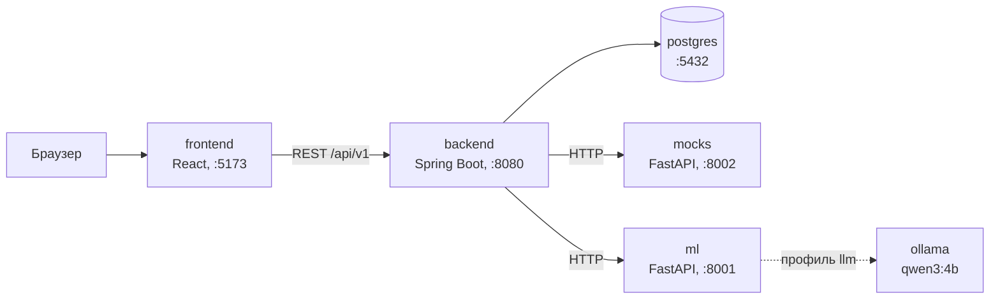

# Кредитный кабинет предпринимателя «Белые пятна»

Прототип цифрового кредитного конвейера для малого и микробизнеса: от выбора продукта и подачи заявки
до решения банка и выдачи кредита. Кейс Альфа-Банка «Умный кредитный кабинет предпринимателя».

## 1. Назначение

Предприниматель хочет быстро понять, на какие условия кредита он может рассчитывать, а банк — оценить
риск по достоверным данным и решить простые заявки без человека. Обычно банк, которому не хватает данных
о клиенте, молча считает по худшему варианту: поднимает ставку, просит залог или отказывает, а недостающее
запрашивает уже после подачи, круг за кругом.

«Белые пятна» меняют этот порядок. Сразу после расчёта клиент видит условия **вилкой** — ставку «от и до» —
и список **белых пятен**: что банк о нём пока не знает и насколько сузится вилка, если пятно закрыть.
Клиент подключает онлайн-кассу или маркетплейс, отвечает на вопрос, загружает документ — вилка сужается
на глазах. Когда она целиком в зоне одобрения, решение принимается автоматически; спорные заявки уходят
андеррайтеру, который видит только открытые пятна. Подробно — `docs/concept.md`.

## 2. Архитектура



Браузер работает только с бэкендом. Бэкенд хранит заявки в PostgreSQL, запрашивает внешние источники
(ЕГРЮЛ, ФНС, БКИ, ОФД, маркетплейс, эквайринг) у сервиса моков и считает вилку в скоринг-сервисе `ml`.
Локальная LLM с открытыми весами работает в отдельном сервисе `ollama` (профиль `llm`) и по умолчанию включена;
без неё всё работает на правилах и словарях.
Кредитное решение принимают детерминированные правила. Схема, потоки, хранение состояния, безопасность и
надёжность — `docs/architecture.md`.

## 3. Требования к окружению

| Что | Требование |
|---|---|
| Docker | Docker Engine с Docker Compose v2 (команда `docker compose`, а не `docker-compose`) |
| Память | с LLM (по умолчанию, `qwen3:4b` на CPU) — от 16 ГБ ОЗУ на машине; без LLM — от 8 ГБ |
| Диск | около 10 ГБ свободного места под сборку образов и зависимости; с LLM ещё около 2,5 ГБ под модель |
| Сеть | только при первой сборке: скачать образы, зависимости и (для режима LLM) модель; дальше всё работает локально |
| Свободные порты | `5173` (сайт), `8080` (бэкенд), `8001` (скоринг), `8002` (моки), `5432` (PostgreSQL) |

Для служебных скриптов (`scripts/check-determinism`, `scripts/demo-ml-prepare`) дополнительно нужны
bash, Python 3.9+ и Node.js (newman запускается через `npx`). В Windows скрипты `scripts/*` запускаются из
Git Bash.

## 4. Запуск

```bash
git clone https://github.com/arthurpels/alphabank_hackaton
cd alphabank_hackaton
git checkout main
cp .env.example .env && docker compose --profile llm up --build
```

В Windows вместо `cp` — `copy .env.example .env`. Первая сборка скачивает образы и зависимости и занимает
несколько минут. Бэкенд после старта контейнера поднимается ещё до минуты.

**Как понять, что всё поднялось.** В другом окне терминала:

```bash
docker compose ps
```

Сервисы `postgres`, `backend`, `frontend`, `ml` и `mocks` должны быть в статусе `healthy`.

| Что открыть | Адрес |
|---|---|
| Сайт | http://localhost:5173 |
| Swagger UI публичного API | http://localhost:8080/swagger-ui.html |
| Проверка бэкенда | http://localhost:8080/health → `{"status":"ok", ...}` |
| Swagger UI скоринг-сервиса | http://localhost:8001/docs |
| Swagger UI моков | http://localhost:8002/docs |

На стартовой странице сайта — кнопки «Действующий пользователь» и «Сотрудник банка».

**Сброс демо-данных** (стирает все заявки и возвращает моки в исходное состояние; стенд должен быть запущен):

```bash
scripts/reset-demo
```

**Остановка:** `docker compose down`. С удалением базы и томов — `docker compose down -v`.

## 5. Конфигурация

Все переменные — в `.env` (копия `.env.example`). Значения по умолчанию подходят для локального запуска;
секретов в репозитории нет.

| Переменная | По умолчанию | Назначение | Когда менять |
|---|---|---|---|
| `POSTGRES_USER` | `alphabank` | пользователь PostgreSQL | не нужно |
| `POSTGRES_PASSWORD` | `alphabank` | пароль PostgreSQL (демо) | при развёртывании вне локальной машины |
| `POSTGRES_DB` | `credit_pipeline` | имя базы | не нужно |
| `SPRING_DATASOURCE_URL` | `jdbc:postgresql://postgres:5432/credit_pipeline` | подключение бэкенда к базе внутри compose | если меняли имя базы |
| `ML_URL` | `http://ml:8001` | адрес скоринг-сервиса для бэкенда | не нужно |
| `MOCKS_URL` | `http://mocks:8002` | адрес моков для бэкенда | не нужно |
| `DEMO_DATE` | `2026-10-23` | дата первого расчёта заявки; от неё считаются возраст бизнеса и срок директора | не менять: от неё зависят исходы персонажей |
| `LLM_ENABLED` | `true` | локальная LLM в `ml` | `false` — режим off, см. ниже |
| `OLLAMA_URL` | `http://ollama:11434` | адрес Ollama для `ml` | Ollama запущена на хосте |
| `OLLAMA_MODEL` | `qwen3:4b` | модель | не нужно |
| `OLLAMA_MODEL_DIGEST` | `359d7dd4…fae7` | закреплённая сборка модели: другая сборка под тем же тегом не используется | не нужно |
| `LLM_TIMEOUT_SECONDS` | `60` | таймаут вызова модели внутри `ml` | медленная машина |
| `ML_LLM_TIMEOUT_MS` | `90000` | таймаут бэкенда к LLM-эндпоинтам `ml` | медленная машина |
| `ML_LLM_CIRCUIT_FAILURES` | `3` | ошибок LLM подряд до размыкания circuit breaker | не нужно |
| `ML_LLM_CIRCUIT_OPEN_MS` | `30000` | пауза circuit breaker, мс | не нужно |
| `LLM_CACHE_PATH` | `/data/llm-cache/verdicts.sqlite` | кеш вердиктов LLM на томе `ml_llm_cache` | не нужно |
| `LLM_REPLAY_PATH` | пусто | файл записанных ответов модели (режим replay) | режимы LLM, см. ниже |
| `LLM_SUMMARY_ENABLED` | `false` | сводка андеррайтеру от LLM вместо шаблона | только с GPU и моделью побольше |
| `VITE_API_URL` | `http://localhost:8080` | адрес бэкенда для браузера | бэкенд на другом порту или хосте |
| `VITE_USE_MOCKS` | `false` | `true` — фронт работает на встроенных данных без бэкенда | только для разработки интерфейса |
| `CORS_ALLOWED_ORIGINS` | пусто — `http://localhost:${FRONTEND_PORT}` | адреса сайта, с которых браузер может обращаться к API, через запятую | сайт открывают не с `localhost` |
| `BACKEND_PORT` | `8080` | порт бэкенда на хосте | порт занят (тогда поменять и `VITE_API_URL`) |
| `FRONTEND_PORT` | `5173` | порт сайта на хосте | порт занят: адрес для CORS бэкенда меняется вместе с ним |
| `ML_PORT` | `8001` | порт скоринг-сервиса на хосте | порт занят |
| `MOCKS_PORT` | `8002` | порт моков на хосте | порт занят |

**Режимы LLM.** Основной сценарий от LLM не зависит: цели и ответы персонажей разбирает словарь, исходы
одинаковы во всех режимах.

| Режим | Что происходит | Как включить |
|---|---|---|
| **live** (по умолчанию) | локальная модель `qwen3:4b` в Ollama, ответы кешируются | запуск из раздела 4: `LLM_ENABLED=true` в `.env` и `docker compose --profile llm up --build`. Первый раз скачивается модель (около 2,5 ГБ); прогреть кеш — `scripts/demo-ml-prepare live` |
| **off** | только правила и словари; то, что словарь не решил, уходит специалисту | в `.env` `LLM_ENABLED=false`, запуск `docker compose up --build` без профиля `llm` |
| **replay** | записанные ответы той же модели, Ollama не нужна | `scripts/demo-ml-prepare replay`; в `.env` — `LLM_ENABLED=true`, `LLM_REPLAY_PATH=/app/eval/replay/llm_answers.jsonl` |

Подробно, с запасным планом и витриной ИИ, — `docs/demo-ml.md`.

## 6. Компоненты

| Сервис | Что делает | Технологии | Порт |
|---|---|---|---|
| `frontend` | кабинет клиента и кабинет андеррайтера | React 18, TypeScript, Vite, Core Components Альфа-Банка | 5173 |
| `backend` | публичный API, статусная машина заявки, пятна, решение, журнал, документы | Java 17, Spring Boot 3.3, Flyway | 8080 |
| `ml` | скоринг-сервис: вилка ставки, сетка иных условий, аномалии выручки, разбор цели и ответов клиента | Python 3.12, FastAPI | 8001 |
| `mocks` | имитация внешних источников: ЕГРЮЛ/ЕГРИП, ФНС, БКИ, ОФД, маркетплейс, эквайринг | Python 3.12, FastAPI | 8002 |
| `postgres` | хранение заявок, пятен, снимков вилки, решений, журнала | PostgreSQL 16 | 5432 |
| `ollama` | локальная LLM `qwen3:4b`, только в профиле `llm` | Ollama 0.12.0 | внутри сети compose |

Сторонние компоненты, лицензии и смоделированные интеграции — `THIRD_PARTY_NOTICES.md`.

## 7. Тестовые данные и учётные записи

Все данные синтетические: пять компаний-персонажей и андеррайтер засеяны при старте (миграция `V6`),
ответы внешних источников зашиты в моки по ИНН. Ещё одна компания, ООО «Теплица», есть только в моках —
для проверки ответа «сезонный спад» (ML-сценарии). ИНН проходят проверку контрольной суммы. Полные данные
и ожидаемые вилки — `docs/synthetic-data.md`.

**Вход демо-упрощённый, без пароля:** на стартовой странице выбирается роль, клиент выбирает компанию.
Для запросов к API пользователь передаётся в заголовке `X-Demo-User` (UUID из таблицы).

| Персонаж | Компания и ИНН | Как войти | `X-Demo-User` | Ожидаемый исход |
|---|---|---|---|---|
| Кофейня | ООО «Кофейня», 7701234560 | «Действующий пользователь» → «ООО «Кофейня» — автоодобрение» | `00000000-0000-0000-0000-000000000101` | кредит на оборудование 2 000 000 ₽ на 36 мес: закрыла три пятна, вилка 17–26 % → 18–19,5 %, автоодобрение |
| Строитель | ИП Петров С. Н., 590234567822 | «Действующий пользователь» → «ИП Петров — андеррайтер, дозапрос, иные условия» | `00000000-0000-0000-0000-000000000102` | оборотный кредит 3 000 000 ₽: андеррайтер запрашивает договор с генподрядчиком и предлагает 1 950 000 ₽ на 36 мес под 20,5 % |
| Продавец на WB | ИП Кузнецова М. И., 590987654351 | «Действующий пользователь» → «ИП Кузнецова — иные условия от системы» | `00000000-0000-0000-0000-000000000103` | оборотный кредит 1 500 000 ₽ не проходит по нагрузке; система сама предлагает 1 200 000 ₽ на 36 мес под 20,5 % или овердрафт 120 000 ₽ под 22,0 % |
| Долг в ФНС | ООО «Техснаб», 7725555556 | «Действующий пользователь» → «ООО «Техснаб» — устранимый стоп-фактор» | `00000000-0000-0000-0000-000000000104` | красное пятно «Долг в ФНС 3 412 ₽»: погасил — автоодобрение под 16–17,5 %; не погасил — отказ с причиной |
| Однодневка | ООО «Однодневка», 7719999994 | «Действующий пользователь» → «ООО «Однодневка» — неустранимые стоп-факторы» | `00000000-0000-0000-0000-000000000105` | новый директор и массовый адрес — автоотказ без андеррайтера |
| Андеррайтер | — | «Сотрудник банка» | `00000000-0000-0000-0000-000000000901` | очередь заявок, проверка ответов, дозапрос, решение |

## 8. Пошаговый сценарий проверки

Перед проверкой — `scripts/reset-demo`. Все сценарии с ожидаемым результатом каждого шага, негативные
проверки и ML-сценарии — `docs/test-scenarios.md`.

### Кофейня: от заявки до выдачи

1. Откройте http://localhost:5173 → «Действующий пользователь» → «ООО «Кофейня» — автоодобрение».
2. На странице «Мои заявки» — «Новая заявка».
3. Продукт «Кредит на оборудование», сумма 2 000 000 ₽, срок 36 мес, цель «2 кофемашины и витрина для
   второй точки», отметьте оба согласия → «Рассчитать».
4. Экран проверки компании в ЕГРЮЛ, ФНС и БКИ → «Посмотреть ставку». Вилка **17–26 %**, четыре пятна:
   «Продажи через кассу не видны», «Не знаем, стабильна ли выручка», «На что именно нужны деньги»,
   «Залог или поручительство — по желанию».
5. Пятно «Продажи через кассу не видны» → «Подключить», отметьте согласие → «Подключить». Вилка
   **18–23,5 %**, появилось пятно «Почему в марте выручка упала на 45 %».
6. Это пятно → «Ответить» → вариант «Был ремонт» → «Отправить ответ». Система сама подтвердила ответ по
   данным кассы: падение разовое. Вилка **18–21 %**.
7. Пятно «На что именно нужны деньги» → «Ответить» → «2 кофемашины и витрина» → «Отправить ответ».
   Вилка **18–19,5 %**: правый край в зоне автоодобрения.
8. «Отправить заявку» → «Заявка одобрена», решение принято системой.
9. «Перейти к оформлению» → «Подписать договор» → «Деньги зачислены» с графиком платежей.
10. Повторная заявка. «Мои заявки» → «Новая заявка» с теми же параметрами. Банк учитывает кредит, который только что
    выдал: над блоком «Из чего складывается ставка» видна строка «Учтены действующие платежи по кредитам:
    73 818,62 ₽ в месяц» (она же есть внутри блока), после подключения кассы вилка уже **19–24,5 %**, а после
    ответов — **19–20,5 %**. Автоодобрения нет: правый край выше 20 %, заявку смотрит специалист, и в его сводке
    вторым пунктом стоит та же строка про действующие платежи.

### ИП Петров: путь андеррайтера

1. «Действующий пользователь» → «ИП Петров — андеррайтер, дозапрос, иные условия» → «Новая заявка».
2. «Кредит на пополнение оборотных средств», 3 000 000 ₽, 12 мес, цель «закупка материалов под договор
   подряда», оба согласия → «Рассчитать» → «Посмотреть ставку». Вилка **17–26 %**.
3. Пятно «На что именно нужны деньги» → «Ответить» → «закупка материалов под договор подряда» →
   «Отправить ответ». Вилка **17–24,5 %**.
4. «Отправить заявку» → «Заявку смотрит специалист»: вилка пересекает порог одобрения.
5. Вернитесь на главную → «Сотрудник банка». В очереди — заявка ИП Петрова, откройте её.
6. «Запросить у клиента»: название «Договор с генподрядчиком», подсказка «Подтвердите будущие
   поступления», тип «Документ», способ закрытия «Загрузка документа», фактор скоринга «Долговая
   нагрузка» → «Отправить клиенту». Заявка переходит в дозапрос.
7. На главной → «Действующий пользователь» → ИП Петров → заявка: «Специалисту нужны уточнения». Пятно
   «Договор с генподрядчиком» → «Загрузить»: файл `scripts/demo-files/builder_contract_gp.pdf`, сумма
   договора 9 600 000 ₽, срок 12 мес → «Загрузить».
8. «Сотрудник банка» → заявка → у ответа клиента «Принимаю». Вилка **21–22,5 %**, но платёж больше 30 %
   выручки — запрошенная сумма не проходит.
9. Решение «Предложить иные условия» → отметьте вариант 1 950 000 ₽ на 36 мес (20,5 %), напишите
   комментарий → «Вынести решение».
10. Клиент ИП Петров → «Банк предлагает другие условия» → выберите вариант → «Принять выбранный вариант» →
    «Подписать договор» → «Деньги зачислены».

### Через API

Коллекция Postman — `docs/credit-pipeline.postman_collection.json`, окружение —
`docs/local.postman_environment.json`: сценарии всех персонажей, негативные проверки, проверки моков и ML.
Описание API — `docs/api.md`.

### Воспроизводимость одной командой

```bash
scripts/check-determinism
```

Скрипт дважды прогоняет коллекцию через newman (между прогонами перезапускает `ml`) и сравнивает ответы:
та же вилка, то же решение, тот же снимок. В конце каждого сценария `POST /applications/{id}/fork/verify`
пересчитывает последний снимок вилки и сверяет его с сохранённым. Код выхода 0 — расхождений нет.
Отчёты newman и логи — во временной папке, путь печатается в конце (свою папку задаёт `DETERMINISM_OUT`).
Нужно: Docker, Node.js (newman запускается через `npx`, версия закреплена в скрипте), Python 3.9+.
**Скрипт стирает демо-заявки** — не запускайте его во время показа.

### Автотесты

| Модуль | Что нужно | Команда |
|---|---|---|
| backend, включая golden-master пяти персонажей | JDK 17, Maven, Docker | `cd server/backend && mvn test` |
| ml | собранный образ (`docker compose up --build`) | команда из `ml/README.md`, раздел «Тесты» |
| frontend, e2e по персонажам | запущенный стенд, Node.js | `cd client/frontend && npm install && npx playwright install chromium && npm run e2e` (подробно — `client/frontend/e2e/README.md`) |

Golden-master `PersonaGoldenMasterTest` поднимает Postgres, моки и `ml` в режиме replay, дважды проводит
пути всех персонажей и сравнивает с эталоном `server/backend/src/test/resources/golden/persona-paths.json`.
Изменение правил, движка или кредитной логики, которое меняет путь персонажа, роняет тест со списком
расхождений. Если изменение осознанное — обновите эталон и закоммитьте его вместе с правкой:

```bash
cd server/backend && mvn test -Dtest=PersonaGoldenMasterTest -Dgolden.update=true
```

## 9. Версия сдачи

| | |
|---|---|
| Ветка | `main` |
| Commit | `b4344e9` |

## 10. Карта документации

**Обязательные по ТЗ**

| Что | Файл |
|---|---|
| README, архитектура, окружение, запуск, сценарий проверки | `README.md` |
| Архитектурная схема | `docs/architecture.md` |
| Описание API | `docs/api.md` |
| OpenAPI | `docs/openapi.yaml` (публичный API), `docs/openapi-ml.yaml` (скоринг), `docs/openapi-mocks.yaml` (моки); Swagger UI — в таблице раздела 4 |
| Коллекция запросов | `docs/credit-pipeline.postman_collection.json`, `docs/local.postman_environment.json` |
| Диаграмма состояний заявки | `docs/day1_backend_application-states.md` |
| Модель данных | `docs/day1_backend_data-model.md` |
| Тестовые сценарии | `docs/test-scenarios.md` |
| Синтетические тестовые данные и учётные записи | `docs/synthetic-data.md` |
| Сторонние компоненты, модели, смоделированные интеграции | `THIRD_PARTY_NOTICES.md` |

**Постановка задачи и рекомендации ТЗ**

| Что | Файл |
|---|---|
| Идея решения | `docs/concept.md` |
| Исследование предметной области и потребностей (JTBD) | `docs/jtbd.md`, `docs/day1_backend_domain-research.md` |
| Модель кредитного процесса: границы, этапы, участники, данные, результаты | `docs/day1_backend_process-model.md` |
| Варианты использования и основной сценарий | `docs/use-cases.md` |
| Границы MVP и упрощения | `docs/mvp-scope.md` |
| Модель принятия решения: скоринг и таблица решений | `docs/scoring-model.md`, `docs/decision-table.md`, `docs/decision-table.json` |
| Смоделированные внешние источники | `docs/day1_backend_external-mocks.md` |
| Роль ИИ и детерминизм | `docs/ai-policy.md`, запуск режимов LLM — `docs/demo-ml.md` |
| Реестр продуктовых и технических решений | `docs/decisions.md` |

Префиксы `day1_backend_` остались от первого дня работы: это основные, актуальные документы.

**Материалы команды** — в `docs/internal/`, для проверки не нужны: текст ТЗ, чек-лист соответствия ТЗ,
доски задач, спецификация экранов, отчёты о качестве ML и калибровке скоринга.

## 11. Что сознательно не делали

| Что | Почему |
|---|---|
| Новостная лента под клиента | организаторы подтвердили, что пункт к этому кейсу не относится (`docs/decisions.md`, Р-16) |
| Реальные интеграции с ЕГРЮЛ, ФНС, БКИ, ОФД, маркетплейсами, эквайрингом | запрещены ТЗ (ограничение 04); вместо них локальные моки |
| Электронная подпись и зачисление денег | смоделированы: договор по шаблону, кнопка «Подписать», график платежей (ТЗ, ограничение 06) |
| Вход по логину и паролю | демо-упрощение: выбор роли и компании, пользователь в заголовке `X-Demo-User` |
| Точный платёж и срок по кредитам в других банках | в БКИ-моке есть лимит и остаток долга, но нет платежа и срока; платёж оценивается условно (`docs/scoring-model.md`, «Действующие обязательства»). Кредиты нашего банка учитываются точно, по договору |
| Кредитный комитет, оценка и регистрация залога, мониторинг после выдачи | вне экспресс-конвейера микро- и малого бизнеса |
| Распределение заявок между андеррайтерами и их полномочия | зона внутренней системы банка; кабинет андеррайтера её эмулирует |

Полный список с обоснованием — `docs/mvp-scope.md`.
