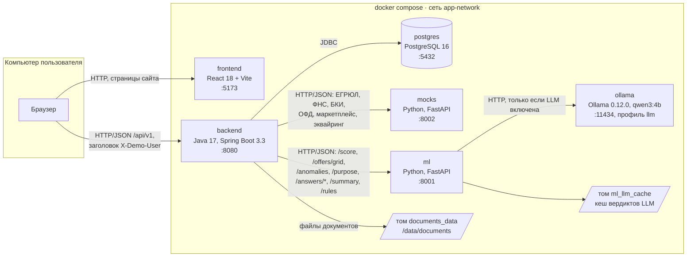
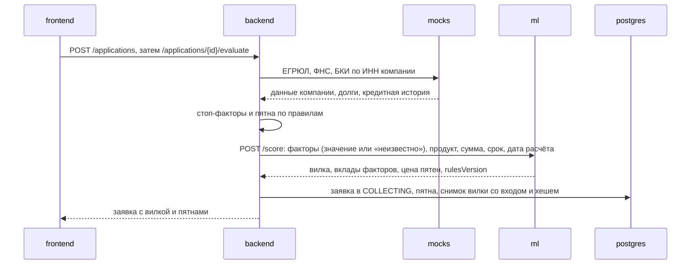

# Архитектура

Кредитный конвейер состоит из шести сервисов в одном `docker-compose.yml`. Пользователь работает только с
сайтом, сайт — только с бэкендом. Бэкенд ведёт заявку по статусной машине, хранит всё в PostgreSQL,
запрашивает внешние источники у сервиса моков и считает вилку ставки в скоринг-сервисе. Кредитное решение
принимают детерминированные правила; локальная LLM с открытыми весами только разбирает свободный текст
клиента и по умолчанию выключена.

## 1. Схема



| Кто вызывает | Кого | Протокол и адрес | Зачем |
|---|---|---|---|
| браузер | frontend | HTTP, `http://localhost:5173` | страницы кабинета клиента и андеррайтера |
| браузер | backend | HTTP/JSON, `http://localhost:8080/api/v1` | все данные и действия; сайт — одностраничное приложение |
| backend | postgres | JDBC, `postgres:5432` | заявки, пятна, снимки вилки, офферы, решения, журнал |
| backend | mocks | HTTP/JSON, `mocks:8002` | внешние источники по ИНН (`docs/openapi-mocks.yaml`) |
| backend | ml | HTTP/JSON, `ml:8001` | скоринг, сетка иных условий, аномалии, разбор цели и ответов, сводка (`docs/openapi-ml.yaml`) |
| ml | ollama | HTTP, `ollama:11434` | локальная модель, только при `LLM_ENABLED=true` и профиле `llm` |

Внешние сервисы не вызываются: все источники — локальные моки, модель работает в том же compose.
Ollama наружу порт не публикует.

## 2. Где хранится состояние

| Что | Где | Переживает перезапуск |
|---|---|---|
| компании, пользователи, заявки, пятна и ответы, снимки вилки, офферы, решения, журнал, сводки андеррайтеру | PostgreSQL, том `postgres_data`; схема — миграции Flyway `V1`–`V13` | да |
| загруженные документы | том `documents_data`, папка `/data/documents` в контейнере бэкенда | да |
| кеш вердиктов LLM | SQLite на томе `ml_llm_cache` (`LLM_CACHE_PATH`) | да |
| веса модели | том `ollama_data` | да |
| ответы внешних источников | зашиты в код моков по ИНН; меняется только долг ФНС после погашения, сброс — `POST /mock/reset` | нет, в памяти сервиса |
| правила скоринга, промпты, словари | файлы `ml/scoring_rules.yaml`, `ml/llm.yaml`, `ml/okved.yaml` в образе `ml` | — |

Сервисы `backend`, `ml` и `mocks` своего состояния в памяти не держат, кроме состояния circuit breaker
бэкенда и долга ФНС в моках. Модель данных — `docs/day1_backend_data-model.md`.

## 3. Ключевые потоки

### Расчёт вилки

Клиент заполнил заявку и нажал «Рассчитать». Синхронно, в одном запросе:



Каждое закрытие пятна повторяет пересчёт и сохраняет новый снимок. Дата расчёта (`asOf`) фиксируется при
первом расчёте, поэтому пересчёт позже даёт ту же вилку.

### Подача и автопроверка

`POST /applications/{id}/submit` синхронно проводит заявку через `SUBMITTED` и `AUTO_CHECK` к итоговому
статусу. Бэкенд обновляет данные источников, проверяет стоп-факторы, пересчитывает вилку и применяет
таблицу решений R1–R6 (`docs/decision-table.md`):

| Условие | Итог |
|---|---|
| открыт неустранимый или непогашенный устранимый стоп-фактор | `REJECTED` с пятном-причиной |
| политика продукта выполнена и правый край ≤ порога одобрения | `APPROVED` |
| запрошенный вариант не проходит, сетка `POST /offers/grid` нашла проходящие | `COUNTER_OFFER`, офферы отмечает система |
| вариантов нет | `REJECTED` с самым дорогим открытым пятном |
| вилка пересекает порог одобрения | `UNDERWRITING` |

Статусы и переходы — `docs/day1_backend_application-states.md`.

### Андеррайтер

При переходе в `UNDERWRITING` бэкенд сохраняет шаблонную сводку фактов. Андеррайтер видит заявку в
очереди (`GET /underwriting/queue`), проверяет ответы клиента (`review`), добавляет пятно-дозапрос
(`UNDERWRITING → INFO_REQUESTED`), выносит решение (`decision`). Варианты иных условий андеррайтер не
считает: их возвращает та же сетка. Клиент видит дозапрос как новое пятно в своём списке; когда он закрыл
все пятна андеррайтера, заявка возвращается в `UNDERWRITING`. Если клиент не отвечает 5 дней,
фоновая задача бэкенда (раз в минуту) отменяет заявку.

### Ответ на пятно с участием LLM

Клиент описал цель кредита или объяснил падение выручки своими словами:

```mermaid
sequenceDiagram
    participant B as backend
    participant S as ml
    participant O as ollama
    B->>B: тот же текст уже разбирался? — берём сохранённый вердикт
    B->>S: POST /purpose или /answers/classify
    S->>S: словарь; решил — ответ без модели
    S->>S: кеш вердиктов; есть — ответ из кеша
    S->>O: вызов модели (только если LLM включена)
    O-->>S: обоснование, цитата, ответ из набора
    S->>S: валидатор правил ответов
    S-->>B: вердикт + кто решил (словарь или модель, версия промпта)
    B->>B: принят — пятно закрыто, вилка пересчитана; не принят — пятно открыто;<br/>спорно или модель недоступна — пятно специалисту
```

Причину падения выручки подтверждают данными правила (`POST /answers/verify`), а не модель. LLM-версия
сводки андеррайтеру, если включена, готовится асинхронно и подменяет шаблон, когда готова; фронт
опрашивает её раз в 3 секунды. Роль ИИ — `docs/ai-policy.md`.

## 4. Безопасность

- **Вход — демо-упрощение.** Логина и пароля нет: на стартовой странице выбирается пользователь из
  засеянных, его UUID передаётся в заголовке `X-Demo-User` каждого запроса. Без заголовка — `401`. В
  реальном продукте заголовок заменяется аутентификацией банка, проверки ролей остаются.
- **Роли.** `CLIENT` работает только с заявками своей компании (чужая — `403`). `UNDERWRITER` — очередь,
  сводка, дозапрос, проверка ответов и решение; клиенту эти действия недоступны (`403`). Роли проверяет
  Spring Security, а допустимость действия в текущем статусе — статусная машина (`409`).
- **Без сессий:** сервер не хранит состояние входа, каждый запрос проверяется заново.
- **CORS:** бэкенд принимает запросы браузера только с адреса сайта `http://localhost:5173`.
- **Секреты** — только в `.env`, в репозитории лишь `.env.example` с демо-значениями.
- **Данные клиента не покидают контур:** модель работает локально, внешних API нет.
- **Документы:** PDF, JPEG, PNG до 10 МБ; скачать может владелец заявки или андеррайтер.
- **Журнал:** каждый переход статуса, действие по пятну, решение и ручная правка условий пишутся в журнал
  заявки (`GET /applications/{id}/history`).

## 5. Надёжность

| Ситуация | Что происходит |
|---|---|
| мок или быстрый эндпоинт `ml` не ответил | таймаут подключения 1,5 с, чтения 4 с, до 3 попыток с паузой 200 мс; затем `503 SOURCE_UNAVAILABLE`, заявка остаётся в прежнем состоянии |
| источник не нашёл данных по ИНН | `404` с понятным текстом; пятно остаётся открытым, его можно закрыть другим способом |
| LLM медленная или недоступна | долгие LLM-эндпоинты: таймаут `ML_LLM_TIMEOUT_MS` (90 с), без повторов; после 3 ошибок подряд circuit breaker размыкается на 30 с |
| модель не ответила | ответ клиента уходит специалисту (`ON_REVIEW`); отказа из-за недоступности модели нет |
| в `ml` другая сборка модели под тем же тегом | модель сверяется по digest и не используется — работают правила |
| сервисы стартуют | у каждого healthcheck; бэкенд стартует только после готовности `postgres`, `ml` и `mocks` |
| нужно доказать решение | снимок вилки хранит полный вход скоринга, его хеш, ответ, версии правил и движка, использованные вердикты LLM; `POST /applications/{id}/fork/verify` пересчитывает и сравнивает байт в байт |

Повторяемость всего пути проверяют `scripts/check-determinism` (два прогона коллекции с перезапуском `ml`)
и golden-master тест `PersonaGoldenMasterTest`.

## 6. Масштабирование и сопровождение

- **Масштабирование.** `ml` и `mocks` без состояния, их можно запускать в нескольких экземплярах за
  балансировщиком. Бэкенд тоже не держит сессий; для нескольких экземпляров документы нужно перенести с
  локального тома в общее хранилище, а фоновую отмену просроченных дозапросов — запускать на одном узле.
  LLM — отдельный сервис: её можно вынести на машину с GPU, поменяв `OLLAMA_URL`.
- **Схема БД** меняется только миграциями Flyway (`server/backend/src/main/resources/db/migration`),
  они применяются при старте бэкенда.
- **Правила скоринга** — один файл `ml/scoring_rules.yaml` с версией `rules_version`; версия сохраняется
  в каждом снимке вилки и решении. Публичная страница «Как мы считаем» (`/rules`) показывает действующие
  правила.
- **Версии ИИ:** модель закреплена по digest, промпты версионируются (`promptVersion`), кеш вердиктов
  разделён по версии модели и промпта; движок скоринга имеет `engineVersion`.
- **Контракты** описаны в OpenAPI: `docs/openapi.yaml`, `docs/openapi-ml.yaml`, `docs/openapi-mocks.yaml`;
  живая спецификация бэкенда — `/v3/api-docs`.
- **Регрессия:** golden-master пяти персонажей падает при любом изменении правил или логики, которое
  меняет их путь.
