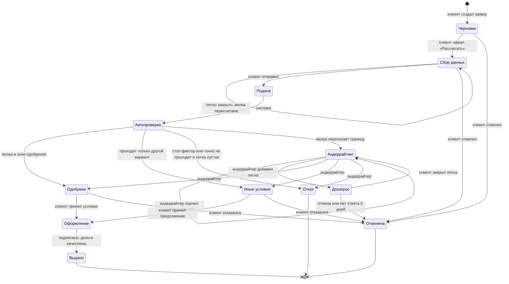

# Диаграмма состояний заявки

> Версия 2: сверено с `data-model.md` (Б2). Хранение сущностей — там,
> здесь — статусы и переходы. Вопросы 1–2 из прошлой версии решены
> (приняты оба), см. «Правила».

Жизненный цикл кредитной заявки: статусы, переходы, кто и при каком условии их инициирует. Коды статусов (английские) используются в API и БД, русские названия — в интерфейсе.

## Статусы

| Код | Статус | Что происходит | Что видит клиент |
|---|---|---|---|
| `DRAFT` | Черновик | клиент выбирает продукт, сумму, срок, цель, даёт согласия | форма параметров |
| `COLLECTING` | Сбор данных | система подтянула источники, посчитала вилку и создала пятна; клиент закрывает пятна, вилка пересчитывается | вилка и список пятен |
| `SUBMITTED` | Подана | заявка зафиксирована, параметры больше не меняются | «Заявка принята» |
| `AUTO_CHECK` | Автопроверка | актуализация источников, стоп-факторы, финальная вилка, правило решения | «Проверяем» |
| `UNDERWRITING` | Андеррайтинг | андеррайтер разбирает открытые пятна | «Заявку смотрит специалист» |
| `INFO_REQUESTED` | Дозапрос | андеррайтер добавил пятна, ждём клиента | новые пятна с пояснением |
| `APPROVED` | Одобрено | решение принято, условия зафиксированы | условия и кнопка «Перейти к оформлению» |
| `COUNTER_OFFER` | Иные условия | банк готов дать деньги на других условиях: сумма, срок, продукт или обеспечение | предложение и чем оно отличается от запроса |
| `REJECTED` | Отказ | отказ с причиной — ссылкой на пятно или стоп-фактор | причина и что можно сделать |
| `SIGNING` | Оформление | договор сформирован, идёт подписание (смоделировано) | договор и кнопка «Подписать» |
| `ISSUED` | Выдано | деньги зачислены (смоделировано) | сумма и график платежей |
| `CANCELLED` | Отменена | клиент отозвал заявку, отказался от условий или не ответил на дозапрос за 5 дней | — |

«Автоодобрение» и «Автоотказ» из общих черновиков — не отдельные статусы, а переходы из `AUTO_CHECK` в `APPROVED` / `REJECTED` с полем решения `decidedBy = SYSTEM`. **Принято.**

## Диаграмма

## Переходы

| # | Из | В | Кто | Условие | Команда API (черновик) |
|---|---|---|---|---|---|
| 1 | — | `DRAFT` | клиент | создал заявку | `POST /applications` |
| 2 | `DRAFT` | `COLLECTING` | клиент | заполнены продукт, сумма, срок, ИНН; даны согласия | `POST /applications/{id}/evaluate` |
| 3 | `COLLECTING` | `COLLECTING` | клиент | закрыл пятно или изменил сумму/срок → новый снимок вилки | `POST /applications/{id}/spots/{spotId}/close`, `PATCH /applications/{id}` |
| 4 | `COLLECTING` | `SUBMITTED` | клиент | нажал «Отправить» | `POST /applications/{id}/submit` |
| 5 | `SUBMITTED` | `AUTO_CHECK` | система | сразу после подачи | — |
| 6 | `AUTO_CHECK` | `APPROVED` | система | нет открытых стоп-факторов, политика продукта выполнена и правый край вилки ≤ порога одобрения (R3) | — |
| 7 | `AUTO_CHECK` | `COUNTER_OFFER` | система | запрошенный вариант точно не проходит (политика не выполнена или левый край > порога одобрения, в том числе в зоне отказа), но в сетке есть проходящий: меньше сумма, дольше срок, поручительство или другой продукт (R4) | — |
| 8 | `AUTO_CHECK` | `REJECTED` | система | открыт стоп-фактор — неустранимый (R1) или непогашенный устранимый (R2); или запрошенный вариант точно не проходит и сетка не нашла проходящих вариантов (R5). Причина — стоп-фактор или самое дорогое незакрытое пятно | — |
| 9 | `AUTO_CHECK` | `UNDERWRITING` | система | всё остальное: вилка пересекает порог одобрения (R6) | — |
| 10 | `UNDERWRITING` | `INFO_REQUESTED` | андеррайтер | добавил пятно клиенту | `POST /applications/{id}/spots` |
| 11 | `INFO_REQUESTED` | `UNDERWRITING` | система | клиент закрыл все пятна андеррайтера | `POST /applications/{id}/spots/{spotId}/close` |
| 12 | `UNDERWRITING` | `UNDERWRITING` | андеррайтер | принял или не принял ответ клиента по пятну → вилка пересчитана | `POST /applications/{id}/spots/{spotId}/review` |
| 13 | `UNDERWRITING` | `APPROVED` / `COUNTER_OFFER` / `REJECTED` | андеррайтер | вынес решение с комментарием; для иных условий — отметил 1–3 варианта из `GET /applications/{id}/offers` | `POST /applications/{id}/decision` |
| 14 | `APPROVED` / `COUNTER_OFFER` | `SIGNING` | клиент | принял условия; в иных условиях — выбрал один из отмеченных вариантов | `POST /applications/{id}/accept` (с `offerId`) |
| 15 | `SIGNING` | `ISSUED` | клиент, система | подписал → зачисление (оба шага смоделированы) | `POST /applications/{id}/sign` |
| 16 | `DRAFT` / `COLLECTING` / `INFO_REQUESTED` / `APPROVED` / `COUNTER_OFFER` | `CANCELLED` | клиент | отменил или отказался | `POST /applications/{id}/cancel` |
| 17 | `INFO_REQUESTED` | `CANCELLED` | система | нет ответа на дозапрос 5 дней | шедулер раз в минуту; для демо — `POST /demo/time/advance` |

## Правила

- Сумму, срок и продукт можно менять только в `DRAFT` и `COLLECTING`.
- Пятна закрываются только в `COLLECTING` и `INFO_REQUESTED`.
- Каждое закрытие пятна сохраняет снимок вилки — видно, как она сужалась.
- Каждый переход пишется в журнал: кто, когда, откуда, куда, причина.
- Решение хранит `decidedBy` (`SYSTEM` / `UNDERWRITER`) и версию правил скоринга — решение можно воспроизвести.
- Отказ всегда ссылается на причину: пятно или стоп-фактор.
- Варианты иных условий считает движок (сетка из `scoring-model.md`) и хранит как предложения (`Offer`). Андеррайтер отмечает 1–3; при автоматических иных условиях (переход 7) система отмечает их сама.
- **Пересчёт вилки устаревает офферы:** все `OFFER` заявки в статусах `CALCULATED`/`OFFERED` переводятся в `EXPIRED`, сетка прогоняется заново (согласовано с `data-model.md`).
- Ручная правка условий андеррайтером — только в пределах полномочий, с комментарием; в решении `override = true`, в журнал пишется diff условий.
- Ответ клиента по пятну получает статус пятна `ON_REVIEW`; андеррайтер переводит его в `CLOSED` (принял) или обратно в `OPEN` с комментарием (не принял). Ответы, подтверждаемые данными источников, система проверяет сама (таблица «кто проверяет» — в `process-model.md` и `data-model.md`).
- **Стоп-факторы двух видов** (по `domain-research.md`): устранимые (долг ФНС) — клиент закрывает действием, заявка идёт дальше; неустранимые (ликвидация, массовый адрес, директор < 3 мес., возраст бизнеса < минимума, текущая просрочка в БКИ) — автоотказ с причиной.
- Недопустимый переход — ошибка `409 Conflict`. Переходы проверяет статусная машина на бэке, а не фронт.
- `REJECTED`, `ISSUED`, `CANCELLED` — финальные статусы, из них переходов нет.
- Срок ответа на дозапрос — 5 дней, потом `CANCELLED`. Срок действия одобрения — в Won't.

## Путь каждого персонажа

| Персонаж | Путь |
|---|---|
| ООО «Кофейня» | `DRAFT → COLLECTING` (закрыла 3 пятна) `→ SUBMITTED → AUTO_CHECK → APPROVED → SIGNING → ISSUED` |
| ИП Петров | `… → AUTO_CHECK → UNDERWRITING → INFO_REQUESTED → UNDERWRITING → COUNTER_OFFER → SIGNING → ISSUED` (андеррайтер отмечает 1 950 000 ₽ на 36 мес) |
| ИП Кузнецова | `… → AUTO_CHECK → COUNTER_OFFER` (1 500 000 ₽ не проходит даже в лучшем случае — платёж 34,7 % выручки при допустимых 30 %; проходят 1 200 000 ₽ на 36 мес или овердрафт 120 000 ₽) `→ SIGNING → ISSUED` |
| ООО «Техснаб» | `COLLECTING` (погасил долг, устранимый стоп-фактор закрыт) `→ … → APPROVED`; если не погасил — `AUTO_CHECK → REJECTED` |
| ООО «Однодневка» | `… → AUTO_CHECK → REJECTED` (неустранимые стоп-факторы: массовый адрес, новый директор) |

Правило решения в `AUTO_CHECK` (переходы 6–9) по шагам, с границами и пятном-причиной, — в
`decision-table.md` (R1–R6); при расхождении верна таблица.

## Принятые решения

1. Полномочия андеррайтера при override: таблицы лимитов нет, достаточно обязательного
   комментария — он фиксируется в решении (`override = true`, `comment`) и журналируется
   с diff условий (ограничение целостности 3 в `data-model.md`).
2. Подачу с открытым устранимым стоп-фактором не блокируем: заявка уходит в `AUTO_CHECK`
   и получает `REJECTED`, если стоп-фактор не закрыт (сценарий «Техснаб не погасил долг»).
3. `rules_version` меняет автор правки в `ml/scoring_rules.yaml` вместе с правками;
   версия приходит в каждом ответе скоринга и сохраняется в снимке вилки и решении.
4. Зона отказа (левый край ≥ порога отказа) сначала идёт в сетку: есть проходящий вариант —
   `COUNTER_OFFER`, нет — `REJECTED` (Р-17, `decision-table.md`).
