# Модель данных

Все сущности системы и их связи. Статусы заявки и переходы — в
`application-states.md` (там же правила статусной машины); здесь — хранение.
Имена пятен, способы закрытия и продукты — из общих договорённостей команды (`concept.md`).

Коды статусов заявки: `DRAFT, COLLECTING, SUBMITTED, AUTO_CHECK, UNDERWRITING,
INFO_REQUESTED, APPROVED, COUNTER_OFFER, REJECTED, SIGNING, ISSUED, CANCELLED`.
«Автоодобрение»/«Автоотказ» — не статусы, а переходы из `AUTO_CHECK`
с `DECISION.decided_by = SYSTEM`.

## ER-диаграмма

```mermaid
erDiagram
    COMPANY ||--o{ APPLICATION : "подаёт"
    USER ||--o{ APPLICATION : "от имени компании"
    PRODUCT ||--o{ APPLICATION : "запрошен"
    APPLICATION ||--o{ SPOT : "пятна"
    APPLICATION ||--o{ FORK_SNAPSHOT : "снимки вилки"
    APPLICATION ||--o{ OFFER : "варианты условий"
    APPLICATION ||--o{ DOCUMENT : "документы"
    APPLICATION ||--o| DECISION : "итог"
    APPLICATION ||--o{ APPLICATION_SOURCE : "подключённые источники"
    DATA_SOURCE ||--o{ APPLICATION_SOURCE : "справочник источников"
    PRODUCT ||--o{ OFFER : "продукт варианта"
    FORK_SNAPSHOT ||--o| OFFER : "вилка варианта"
    OFFER ||--o| DECISION : "основание решения"
    SPOT ||--o{ SPOT_ANSWER : "ответы клиента"
    DOCUMENT ||--o{ SPOT_ANSWER : "подтверждение"
    USER ||--o{ DECISION : "кем вынесено"
    USER ||--o{ SPOT_ANSWER : "кем проверен ответ"
    APPLICATION ||--o{ AUDIT_LOG : "история"
    USER ||--o{ AUDIT_LOG : "автор действия"

    COMPANY {
        uuid id PK
        string inn "10/12 цифр, уникален"
        string name
        string legal_form "OOO | IP"
        json egrul_snapshot "последний ответ мока ЕГРЮЛ/ЕГРИП"
    }

    USER {
        uuid id PK
        uuid company_id FK "null = сотрудник банка"
        string role "CLIENT | UNDERWRITER"
        string fio
    }

    PRODUCT {
        uuid id PK
        string code "WORKING_CAPITAL | EQUIPMENT | OVERDRAFT"
        string name
        bigint min_amount
        bigint max_amount
        json allowed_terms "например [12, 24, 36]"
    }

    APPLICATION {
        uuid id PK
        uuid company_id FK
        uuid user_id FK "кто подал"
        uuid product_id FK
        bigint amount "коп."
        int term_months
        string goal "цель, свободный текст"
        string status "см. application-states.md"
        date as_of "фиксируется при первом расчёте; null в DRAFT"
        timestamp created_at
        timestamp submitted_at
        timestamp info_requested_at "для таймаута дозапроса"
    }

    SPOT {
        uuid id PK
        uuid application_id FK
        string type "NO_DATA | ANOMALY | DOCUMENT | STOP_FACTOR | COLLATERAL"
        string title
        string client_hint "пояснение для клиента"
        string scoring_factor "затронутый фактор скоринга"
        numeric price_pp "цена в п.п. (насколько сузится вилка)"
        string close_method "CONNECT_SOURCE | ANSWER | UPLOAD | PAY | ADD_COLLATERAL | null (неустранимый стоп-фактор)"
        boolean removable "только для STOP_FACTOR: можно ли устранить действием"
        json answer_options "варианты ответа для ANSWER: [{code, label}]"
        string status "OPEN | ON_REVIEW | CLOSED"
        string added_by "SYSTEM | UNDERWRITER"
        string source "BKI | EGRUL | FNS | OFD | MARKETPLACE | ACQUIRING | REPUTATION | null"
        timestamp created_at
        timestamp closed_at
    }

    SPOT_ANSWER {
        uuid id PK
        uuid spot_id FK
        string option_code "выбранный вариант ответа или итог проверки: MATCH / MISMATCH для цели, GUARANTEE / PLEDGE / DECLINED для обеспечения"
        string text "свободный ответ клиента"
        uuid document_id FK "может быть null"
        bigint contract_amount "сумма договора из ответа клиента, копейки; выручка = сумма / срок"
        int contract_term_months "срок договора, месяцев; вместе с contract_amount"
        string verdict "PENDING | ACCEPTED | REJECTED"
        string reviewed_by "SYSTEM | <user_id>"
        string review_comment "при REJECTED показывается клиенту"
        timestamp created_at
        timestamp reviewed_at
        json purpose_verdict "ответ /purpose для пятна цели: статус, значение, кто решил, обоснование, llm.*, продукт"
    }

    FORK_SNAPSHOT {
        uuid id PK
        uuid application_id FK
        numeric rate_from
        numeric rate_to
        numeric approve_max "порог автоодобрения продукта на момент расчёта"
        numeric reject_min "порог отказа продукта на момент расчёта"
        string rules_version "версия YAML-правил, воспроизводимость"
        date as_of "дата входа для скоринга; совпадает с APPLICATION.as_of"
        timestamp calculated_at
    }

    OFFER {
        uuid id PK
        uuid application_id FK
        uuid product_id FK "может отличаться от запрошенного"
        bigint amount
        int term_months
        string collateral_type "null = без обеспечения"
        string collateral_comment
        uuid fork_snapshot_id FK "вилка, пересчитанная под этот вариант"
        string proposed_by "SYSTEM | UNDERWRITER"
        string status "CALCULATED | OFFERED | CHOSEN | DECLINED | EXPIRED"
        string comment "обязателен при ручной правке андеррайтера"
        timestamp created_at
        timestamp chosen_at
    }

    DECISION {
        uuid id PK
        uuid application_id FK
        string type "APPROVED | ALTERNATIVE | REJECTED"
        uuid offer_id FK "для ALTERNATIVE — выбранный клиентом оффер"
        string decided_by "SYSTEM | UNDERWRITER"
        uuid decided_by_user_id FK "андеррайтер; null у системы"
        string rules_version
        boolean override "true = ручная правка условий андеррайтером"
        string comment "обязателен при override = true; при REJECTED — причина"
        uuid reason_spot_id FK "при REJECTED — пятно/стоп-фактор-причина"
        timestamp decided_at
    }

    DOCUMENT {
        uuid id PK
        uuid application_id FK
        string kind "например CONTRACT_GP, REPAIR_CONTRACT"
        string file_path "имя файла в хранилище backend (volume /data/documents)"
        string original_name "имя файла от клиента, отдаётся при скачивании"
        string content_type "application/pdf | image/jpeg | image/png"
        timestamp uploaded_at
    }

    DATA_SOURCE {
        string code PK "BKI | EGRUL | FNS | OFD | MARKETPLACE | ACQUIRING | REPUTATION"
        string name
        boolean requires_consent
    }

    APPLICATION_SOURCE {
        uuid id PK
        uuid application_id FK
        string source_code FK
        boolean consent_given
        timestamp connected_at
    }

    AUDIT_LOG {
        uuid id PK
        uuid application_id FK
        uuid user_id FK "null = система"
        string event "STATUS_CHANGE | SPOT_* | OFFER_* | DECISION | OVERRIDE"
        string from_state
        string to_state
        json payload "diff изменений; для override — старые и новые условия"
        string reason
        timestamp created_at
    }
```



## Статусная машина OFFER

```
CALCULATED → OFFERED → CHOSEN
                  ↘ DECLINED
                  ↘ EXPIRED   (вилка заявки пересчитана — снимок устарел)
```

- `CALCULATED` — движок посчитал вариант сетки и он проходит (верхний край ≤
  порога одобрения). Непроходящие варианты не сохраняются.
- `OFFERED` — показан клиенту: вариант сетки отмечен андеррайтером, ручной вариант андеррайтера (`proposed_by=UNDERWRITER`, с комментарием), оффер на запрошенных условиях при одобрении
  или автопредложен системой при переходе `AUTO_CHECK → COUNTER_OFFER`.
- `CHOSEN` — клиент принял через `POST /applications/{id}/accept {offerId}`;
  заявка уходит в `SIGNING`.
- `EXPIRED` — любой пересчёт вилки заявки (закрыто пятно, изменены параметры)
  устаревает все `CALCULATED`/`OFFERED` этой заявки; сетка прогоняется заново.

## Кто проверяет ответ по пятну

Согласовано с `process-model.md`:

| Как клиент закрыл пятно | Кто проверяет | `reviewed_by` |
|---|---|---|
| Подключил источник | система | `SYSTEM` |
| Действие (погасил долг ФНС) | система — повторный запрос | `SYSTEM` |
| Ответ, подтверждённый данными | система | `SYSTEM` |
| Ответ, данными не подтвердить | андеррайтер | user_id |
| Загрузил документ (дозапрос) | андеррайтер | user_id |
| Поручительство собственника | система | `SYSTEM` |
| Залог | андеррайтер | user_id |

Пока `verdict = PENDING`, вилка ответ не учитывает; пятно в `ON_REVIEW`,
клиент видит «Передано на проверку специалисту».

## Стоп-факторы (согласовано с domain-research.md)

Стоп-фактор — пятно типа `STOP_FACTOR`, бывает двух видов:
- **устранимое** (долг в ФНС) — клиент закрывает действием (`PAY`),
  заявка продолжает путь;
- **неустранимое** (ликвидация, массовый адрес, директор < 3 мес.,
  возраст бизнеса < минимума, текущая просрочка в БКИ) — автоотказ с причиной.

Так «Однодневка» уходит в `REJECTED` сразу в `AUTO_CHECK`, без андеррайтера.

## Ограничения целостности

1. У заявки не более одного `OFFER` в статусе `CHOSEN` и не более одного
   `DECISION`.
2. `OFFERED` — только из `CALCULATED` и только если верхний край вилки
   снимка ≤ порога одобрения.
3. `DECISION.override = true` ⇒ `comment` обязателен + событие `OVERRIDE`
   в AUDIT_LOG с diff условий.
4. `DECISION.type = REJECTED` ⇒ `reason_spot_id` обязателен (отказ всегда
   с причиной).
5. `SPOT.status = ON_REVIEW` ⇔ существует `SPOT_ANSWER` с `verdict = PENDING`.
6. `SPOT_ANSWER.verdict = ACCEPTED` ⇒ пятно `CLOSED` + пересчёт вилки +
   офферы в `EXPIRED`. `REJECTED` ⇒ пятно `OPEN`, клиент видит
   `review_comment`.
7. Параметры заявки (сумма, срок, продукт) меняются только в `DRAFT` и
   `COLLECTING`.
8. Каждый переход статуса заявки — событие `STATUS_CHANGE` в AUDIT_LOG
   (кто, откуда, куда, причина).
9. `FORK_SNAPSHOT.rules_version` = версии YAML-правил из `ml/`; решение и
   любую вилку можно пересчитать заново и получить тот же результат.

## Стыки API (для OpenAPI, день 2)

- `GET /applications/{id}/offers` → офферы `CALCULATED`/`OFFERED`;
- `POST /applications/{id}/decision` { type, offer_ids[], comment, override };
- `POST /applications/{id}/accept` { offerId } → OFFER `CHOSEN`, заявка `SIGNING`;
- `POST /applications/{id}/spots/{spotId}/review` { verdict, comment };
- `POST /applications/{id}/spots/{spotId}/close` → пересчёт вилки, снимок.
