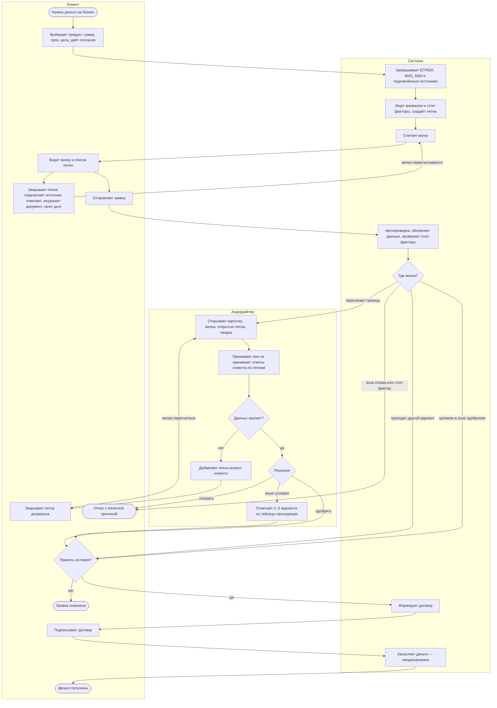

# Модель кредитного процесса

Кто что делает от возникновения потребности до выдачи денег. Три участника: клиент, система (конвейер) и андеррайтер. Статусы заявки описаны в `application-states.md`.

## Диаграмма

## Шаги

| Шаг | Кто | Как | Статус заявки |
|---|---|---|---|
| Параметры заявки | клиент | вручную, ИНН и данные компании подставляются из ЕГРЮЛ | `DRAFT` |
| Сбор данных, пятна, вилка | система | автоматически | `COLLECTING` |
| Закрытие пятен | клиент | по желанию, каждое пятно — одна кнопка | `COLLECTING` |
| Подача | клиент | одна кнопка | `SUBMITTED` |
| Автопроверка и правило решения | система | автоматически, по краям вилки | `AUTO_CHECK` |
| Разбор серой зоны | андеррайтер | вручную, только открытые пятна | `UNDERWRITING` |
| Дозапрос | андеррайтер → клиент | пятно в том же списке, без писем | `INFO_REQUESTED` |
| Решение | система или андеррайтер | одобрено, иные условия или отказ | `APPROVED` / `COUNTER_OFFER` / `REJECTED` |
| Оформление и выдача | клиент, система | смоделировано | `SIGNING` → `ISSUED` |

## Работа андеррайтера

**Карточка заявки:**
- вилка и зоны — та же картинка, что у клиента;
- открытые пятна с ценой каждого; закрытые свёрнуты;
- сводка от LLM: 3–5 выводов, у каждого ссылка на факт-источник (БКИ, выписка, ЕГРЮЛ).

**Действия:**
1. **Оценить ответ по пятну** — «Принимаю» / «Не принимаю». Пятно закрывается проверенным значением, вилка пересчитывается. Часто после этого заявка решается сама. Андеррайтер видит только то, что система не смогла проверить сама:

| Как клиент закрыл пятно | Кто проверяет |
|---|---|
| Подключил источник (ОФД, маркетплейс, эквайринг) | система — данные пришли из источника |
| Сделал действие (погасил долг в ФНС) | система — повторный запрос в источник |
| Ответил «ремонт» на падение выручки, и данные это подтверждают: падение разовое, в следующем месяце выручка восстановилась | система |
| Описал цель кредита, и скоринг её распознал (`/purpose`) | система |
| Ответил, но данными это не подтвердить | андеррайтер |
| Загрузил документ (дозапрос) | андеррайтер |
| Поручительство собственника | система (согласие в кабинете) |
| Залог | андеррайтер |

Пока ответ не проверен, вилка его не учитывает, а клиент видит «Передано на проверку специалисту».
2. **Добавить пятно** (дозапрос): тип и пояснение для клиента. Пятно появляется у клиента в том же списке.
3. **Вынести решение:** одобрить, предложить иные условия или отказать. Отказ — только с причиной (пятно или стоп-фактор).

**Как подбираются иные условия.** Вручную их никто не считает. Движок прогоняет сетку вариантов через тот же расчёт вилки и показывает только проходящие. Пример — ИП Петров после принятого договора с генподрядчиком (`synthetic-data.md`, раздел 5):

| Вариант | Сумма | Срок | Продукт / обеспечение | Ставка | Итог |
|---|---|---|---|---|---|
| Как просил | 3 000 000 ₽ | 12 мес. | оборотный | 21,0–22,5 % | нагрузка 34,7 % > 30 % — не проходит |
| A | 1 950 000 ₽ | 36 мес. | оборотный, без обеспечения | 20,5 % | проходит, нагрузка 9,1 % |

- Сетка: сумма −20 / −35 / −50%, срок дольше, другой продукт, добавить обеспечение. Какие именно шаги — описывает ML в `scoring-model.md`.
- Андеррайтер отмечает 1–3 разумных варианта и пишет комментарий. Клиент в статусе «Иные условия» выбирает из отмеченных.
- Ручная правка (например, 1,2 млн) разрешена только в пределах полномочий и с комментарием; в журнал пишется `override = true`.
- Если запрошенный вариант не проходит, а другие проходят, система предлагает их сама, без андеррайтера.

Так решения одинаковые у разных сотрудников и воспроизводимы, а клиент получает выбор вместо одного «берите или уходите». Это закрывает фразу ТЗ: «одинаковая оценка риска может приводить к разным условиям для разных продуктов».

## Что автоматизировано

- **Система делает сама:** сбор данных из источников, поиск аномалий и стоп-факторов, пятна, расчёт вилки, решение по ясным заявкам (верхний край в зоне одобрения или нижний — в зоне отказа), предложение «иных условий», если проходит другой вариант.
- **Человек нужен только** для заявок, у которых вилка пересекает границу зон. Андеррайтер видит не всю заявку, а открытые пятна и сводку.
- **Весь путь проходит внутри продукта** (ограничение 05): дозапрос — это пятно в кабинете клиента, а не письмо или звонок.

## Границы процесса в MVP

- **Начало:** клиент открывает кабинет и создаёт заявку.
- **Конец:** деньги зачислены (смоделировано), отказ или отмена.
- **Не моделируем:** кредитный комитет, оценку и регистрацию залога, реальное подписание ЭП, мониторинг после выдачи. Обоснование — в `domain-research.md`.
- **Андеррайтинг смоделирован.** В реальном банке здесь заявка передаётся во внутреннюю систему банка: там распределяют задачи между сотрудниками и проверяют их полномочия. В прототипе эту систему эмулирует кабинет андеррайтера: он получает заявки из очереди и вызывает API продукта. Лимитов и данных сотрудников в продукте нет — это зона внутренней системы банка (ТЗ, ограничение 06).
