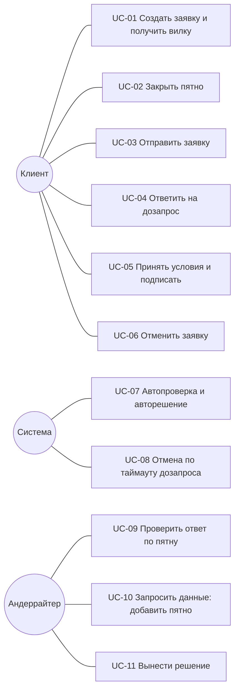

# Варианты использования и основной сценарий

Как клиент и сотрудник банка проходят кредитный процесс. Каждый шаг сценария —
переход статусной машины: номера переходов и коды статусов взяты из
`day1_backend_application-states.md`, запросы — из `openapi.yaml`. Под каждым
шагом указан экран.

Участников трое: **клиент** (представитель бизнеса), **система** (кредитный
конвейер) и **андеррайтер** (сотрудник банка). Весь путь проходит внутри
продукта: без писем, звонков и SMS (ограничение ТЗ 05).

---

## 1. Экраны

| Экран | Адрес | Кто видит | Что на экране |
|---|---|---|---|
| Стартовая | `/` | все | выбор роли: «Действующий пользователь» или «Сотрудник банка» |
| Выбор компании | `/client` | клиент | список тестовых компаний |
| Новая заявка | `/client/new` | клиент | компания, продукт, сумма, срок, цель кредита, согласия на запрос в БКИ и обработку персональных данных |
| Заявка | `/client/application` | клиент | вид зависит от статуса заявки (таблица ниже) |
| Кабинет андеррайтера | `/underwriter` | андеррайтер | очередь заявок и карточка заявки: вилка, открытые пятна, ответы клиента, сводка; действия по пятнам и решение |

Экран «Заявка» в разных статусах:

| Статус | Что видит клиент |
|---|---|
| `DRAFT` | «Заявка ещё не рассчитана» |
| `COLLECTING`, `INFO_REQUESTED` | вилка ставки, список пятен «Что банк о вас пока не знает», кнопка «Отправить заявку» |
| `SUBMITTED`, `AUTO_CHECK` | «Заявка принята, проверяем» |
| `UNDERWRITING` | «Заявку смотрит специалист» и пятна на проверке |
| `APPROVED` | «Заявка одобрена»: условия, принять или отказаться |
| `COUNTER_OFFER` | «Банк предлагает другие условия»: варианты, выбрать один или отказаться |
| `REJECTED` | «Мы не можем одобрить заявку»: причина-пятно и что можно сделать |
| `SIGNING` | «Оформление договора»: договор и кнопка «Подписать» |
| `ISSUED` | «Деньги зачислены»: сумма и график платежей |
| `CANCELLED` | «Заявка отменена» |

---

## 2. Варианты использования

| UC | Актор | Цель | Результат | Переходы | Экраны |
|---|---|---|---|---|---|
| UC-01 | клиент | понять, на что можно рассчитывать | вилка ставки и список пятен | 1, 2 | Выбор компании, Новая заявка, Заявка |
| UC-02 | клиент | улучшить условия | пятно закрыто, вилка сузилась | 3 | Заявка |
| UC-03 | клиент | получить решение | заявка на автопроверке | 4, 5 | Заявка |
| UC-04 | клиент | ответить специалисту | пятна дозапроса закрыты | 11 | Заявка |
| UC-05 | клиент | получить деньги | договор подписан, деньги зачислены (смоделировано) | 14, 15 | Заявка |
| UC-06 | клиент | отказаться от заявки или условий | заявка отменена | 16 | Заявка |
| UC-07 | система | решить ясные заявки без человека | одобрено / иные условия / отказ / передано андеррайтеру | 6, 7, 8, 9 | Заявка |
| UC-08 | система | не держать брошенные заявки | отмена через 5 дней без ответа на дозапрос | 17 | Заявка |
| UC-09 | андеррайтер | проверить то, что система не может проверить сама | ответ принят или возвращён с комментарием | 12 | Кабинет андеррайтера |
| UC-10 | андеррайтер | получить недостающие данные | новое пятно у клиента | 10 | Кабинет андеррайтера |
| UC-11 | андеррайтер | решить спорную заявку | одобрено / иные условия / отказ с причиной | 13 | Кабинет андеррайтера |

---

## 3. Основной сценарий: от входа в кабинет до выдачи

Пример — ООО «Кофейня»: кредит на оборудование, 2 000 000 ₽ на 36 месяцев.
Данные и цифры персонажей — в `synthetic-data.md`.

| # | Кто | Действие | Что делает система | Запрос | Переход | Статус после | Экран |
|---|---|---|---|---|---|---|---|
| 1 | клиент | «Действующий пользователь» → выбирает компанию | показывает форму новой заявки | `GET /demo/users` | — | — | Стартовая → Выбор компании → Новая заявка |
| 2 | клиент | выбирает продукт, сумму, срок, описывает цель, даёт оба согласия | проверяет сумму и срок по продукту | — | — | — | Новая заявка |
| 3 | клиент | «Рассчитать» | создаёт заявку; запрашивает ЕГРЮЛ, ФНС, БКИ; проверяет стоп-факторы; считает вилку; создаёт пятна | `POST /applications`, `POST /applications/{id}/evaluate` | 1, 2 | `COLLECTING` | Заявка |
| 4 | клиент | закрывает пятно «Продажи через кассу не видны»: подключает ОФД | получает выручку, ищет аномалии, пересчитывает вилку, сохраняет её снимок | `POST /applications/{id}/spots/{spotId}/close` | 3 | `COLLECTING` | Заявка |
| 5 | клиент | отвечает на пятно-аномалию «Почему в марте выручка упала на 45 %» и прикладывает документ | проверяет ответ по данным: падение разовое, выручка восстановилась → пятно закрыто, вилка пересчитана | `POST /applications/{id}/documents`, `POST /applications/{id}/spots/{spotId}/close` | 3 | `COLLECTING` | Заявка |
| 6 | клиент | закрывает пятно «На что именно нужны деньги» | распознаёт цель и сверяет её с продуктом, пересчитывает вилку | `POST /applications/{id}/spots/{spotId}/close` | 3 | `COLLECTING` | Заявка |
| 7 | клиент | «Отправить заявку» | фиксирует параметры, дальше их не изменить | `POST /applications/{id}/submit` | 4 | `SUBMITTED` | Заявка |
| 8 | система | — | обновляет данные источников, проверяет стоп-факторы, считает финальную вилку | — | 5 | `AUTO_CHECK` | Заявка |
| 9 | система | — | политика продукта выполнена, правый край вилки ≤ порога одобрения → автоодобрение | — | 6 | `APPROVED` | Заявка |
| 10 | клиент | принимает условия | формирует договор по шаблону | `POST /applications/{id}/accept` | 14 | `SIGNING` | Заявка |
| 11 | клиент | «Подписать» | моделирует подписание и зачисление, строит график платежей | `POST /applications/{id}/sign` | 15 | `ISSUED` | Заявка |

На шагах 4–6 клиент закрывает столько пятен, сколько хочет, в любом порядке,
и может отправить заявку в любой момент. До отправки параметры заявки можно
менять (переход 3), после — нет. Какие действия доступны сейчас, экран
получает от бэкенда в поле `availableActions`.

**Как закрываются пятна:**

| Способ | Действие клиента | Кто проверяет | Что видит клиент |
|---|---|---|---|
| `CONNECT_SOURCE` | даёт согласие на подключение источника | система: данные пришли из источника | пятно закрыто, вилка сузилась |
| `ANSWER` | пишет ответ, при необходимости прикладывает документ | система, если ответ подтверждается данными; иначе андеррайтер | пятно закрыто или передано на проверку специалисту |
| `UPLOAD` | загружает документ | андеррайтер | пятно на проверке у специалиста |
| `PAY` | гасит долг | система: повторный запрос в источник | красное пятно закрыто |
| `ADD_COLLATERAL` | оформляет поручительство или предлагает залог | поручительство — система, залог — андеррайтер | пятно закрыто или на проверке |

Пока ответ на проверке, вилка его не учитывает.

---

## 4. Ветки

### Б-1. Андеррайтер и дозапрос

Начинается на шаге 8 основного сценария, когда вилка пересекает порог
одобрения. Пример — ИП Петров (строитель).

| # | Кто | Действие | Что делает система | Запрос | Переход | Статус после | Экран |
|---|---|---|---|---|---|---|---|
| 1 | система | — | вилка пересекает порог → заявка уходит андеррайтеру | — | 9 | `UNDERWRITING` | Заявка: «Заявку смотрит специалист» |
| 2 | андеррайтер | открывает заявку из очереди | показывает вилку, открытые пятна, ответы клиента, сводку | `GET /underwriting/queue`, `GET /underwriting/applications/{id}/summary` | — | `UNDERWRITING` | Кабинет андеррайтера |
| 3 | андеррайтер | добавляет пятно: тип, пояснение, чем закрыть (например, договор с генподрядчиком или акт сверки) | пятно появляется у клиента в том же списке | `POST /applications/{id}/spots` | 10 | `INFO_REQUESTED` | Кабинет андеррайтера; у клиента — Заявка |
| 4 | клиент | закрывает пятна дозапроса | когда закрыты все пятна андеррайтера, заявка возвращается к нему | `POST /applications/{id}/spots/{spotId}/close` | 11 | `UNDERWRITING` | Заявка |
| 5 | андеррайтер | «Принимаю» или «Не принимаю» по каждому ответу | принят — пятно закрыто, вилка пересчитана; не принят — пятно снова открыто, клиент видит комментарий | `POST /applications/{id}/spots/{spotId}/review` | 12 | `UNDERWRITING` | Кабинет андеррайтера |
| 6 | андеррайтер | выносит решение: одобрить, иные условия (Б-2) или отказ (Б-3) | сохраняет решение с комментарием | `POST /applications/{id}/decision` | 13 | `APPROVED` / `COUNTER_OFFER` / `REJECTED` | Кабинет андеррайтера; у клиента — Заявка |

Шаги 3–5 можно повторять. Если клиент 5 дней не отвечает на дозапрос, система
отменяет заявку (переход 17).

### Б-2. Иные условия

Запрошенный вариант не проходит, но проходит другой: меньше сумма, другой срок
или продукт. Варианты считает движок (сетка из `scoring-model.md`), вручную их
никто не подбирает.

| # | Кто | Действие | Что делает система | Запрос | Переход | Статус после | Экран |
|---|---|---|---|---|---|---|---|
| 1а | система | — | на автопроверке запрошенный вариант не проходит (политика не выполнена или левый край > порога одобрения), в сетке есть проходящие → система сама отмечает их (пример — ИП Кузнецова) | — | 7 | `COUNTER_OFFER` | Заявка: «Банк предлагает другие условия» |
| 1б | андеррайтер | отмечает 1–3 варианта из проходящих, пишет комментарий (пример — ИП Петров) | сохраняет решение | `GET /applications/{id}/offers`, `POST /applications/{id}/decision` | 13 | `COUNTER_OFFER` | Кабинет андеррайтера; у клиента — Заявка |
| 2 | клиент | сравнивает варианты с запросом, выбирает один | фиксирует выбранный вариант, формирует договор | `POST /applications/{id}/accept` | 14 | `SIGNING` | Заявка |
| 3 | клиент | подписывает | как в основном сценарии | `POST /applications/{id}/sign` | 15 | `ISSUED` | Заявка |

Андеррайтер может поправить условия вручную только с обязательным
комментарием: в решении отмечается ручная правка, разница условий пишется в
журнал. Лимиты полномочий в продукте не хранятся (`mvp-scope.md`).

### Б-3. Отказ

Отказ всегда ссылается на причину: пятно или стоп-фактор.

| Когда | Кто | Переход | Причина, которую видит клиент |
|---|---|---|---|
| открыт неустранимый стоп-фактор: компания не действует, бизнесу меньше 6 месяцев, директор назначен меньше 3 месяцев назад, массовый адрес, текущая просрочка в БКИ (пример — ООО «Однодневка») | система | 8 | красное пятно-стоп-фактор; оно видно ещё до отправки |
| отправил, не закрыв устранимый стоп-фактор — долг в ФНС (пример — ООО «Техснаб» без погашения) | система | 8 | красное пятно «Долг в ФНС» |
| левый край вилки ≥ порога отказа, или сетка не нашла проходящих вариантов | система | 8 | самое дорогое открытое пятно |
| андеррайтер решил отказать | андеррайтер | 13 | выбранное андеррайтером пятно и комментарий |

На экране отказа — что можно сделать дальше, например погасить долг и подать
новую заявку.

### Б-4. Отмена

| Когда | Кто | Переход | Запрос |
|---|---|---|---|
| передумал до отправки (`DRAFT`, `COLLECTING`) или во время дозапроса (`INFO_REQUESTED`) | клиент | 16 | `POST /applications/{id}/cancel` |
| отказался от одобренных или иных условий (`APPROVED`, `COUNTER_OFFER`) | клиент | 16 | `POST /applications/{id}/cancel` |
| не ответил на дозапрос 5 дней | система | 17 | — |

После отправки и до решения (`SUBMITTED`, `AUTO_CHECK`, `UNDERWRITING`) клиент
заявку не отменяет: таких переходов в статусной машине нет.

### Б-5. Источник не нашёл данных

Клиент подключает источник, а данных о компании в нём нет (ответ `404`).
Пятно остаётся открытым, клиент видит сообщение и может закрыть пятно другим
способом. Статус не меняется (`COLLECTING`). Пример — ИП Петров без кассы и
эквайринга.

---

## 5. Сценарии андеррайтера

| Задача | Шаги | Запросы | Переходы |
|---|---|---|---|
| Разобрать очередь | открывает очередь → видит заявки в `UNDERWRITING` и `INFO_REQUESTED`, у каждой вилку и число открытых пятен → открывает карточку | `GET /underwriting/queue` | — |
| Проверить ответ | читает ответ клиента и документ → «Принимаю» или «Не принимаю» с комментарием | `POST /applications/{id}/spots/{spotId}/review` | 12 |
| Запросить данные | добавляет пятно: тип, пояснение для клиента, чем закрыть | `POST /applications/{id}/spots` | 10 |
| Решить заявку | одобрить / иные условия (отметить 1–3 варианта) / отказать с причиной-пятном; комментарий обязателен | `GET /applications/{id}/offers`, `POST /applications/{id}/decision` | 13 |

Андеррайтер видит не всю заявку, а только то, что система не смогла решить
сама: открытые пятна и ответы на проверке.

---

## 6. Персонажи и ветки

| Персонаж | Ветка |
|---|---|
| ООО «Кофейня» | основной сценарий, автоодобрение |
| ИП Петров (строитель) | Б-5 → Б-1 (дозапрос договора) → Б-2 (иные условия от андеррайтера) |
| ИП Кузнецова (продавец на WB) | Б-2 (иные условия от системы) |
| ООО «Техснаб» (долг в ФНС) | основной сценарий с закрытием красного пятна; без погашения — Б-3 |
| ООО «Однодневка» | Б-3 (неустранимые стоп-факторы) |

Ветку Б-4 (отмена) можно проверить на любом персонаже.
