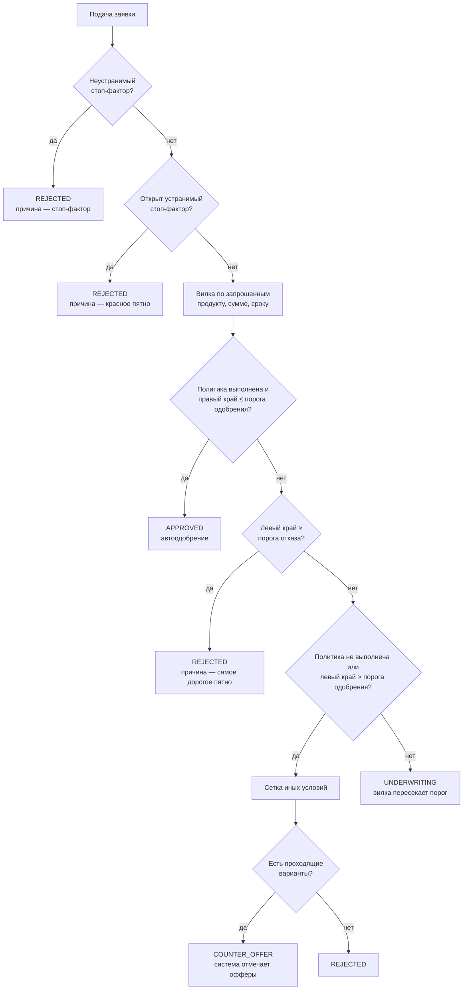

# Модель скоринга

> Черновик T06, версия правил `2026-10-23.draft1`. Цифры синтетические и
> откалиброваны так, чтобы пять персонажей получали нужные вердикты.
> Согласовать с Лидом (формат YAML → T10, движок → T24).

Скоринг даёт **вилку ставки** — диапазон «от и до», а не одну цифру. Вилка
считается детерминированно: одинаковые данные и одна версия правил всегда дают
одинаковую вилку. LLM в расчёте и в решении не участвует.

Модель состоит из двух частей, как требует ТЗ («скоринговая оценка ≠
кредитное решение»):

- **Скоринг** — факторы риска → вилка ставки.
- **Кредитная логика** — стоп-факторы, политика продукта (лимиты нагрузки,
  суммы, сроки), пороги решения и сетка иных условий.

Поэтому одинаковый риск даёт разные условия на разных продуктах: у
WB-продавца при одних и тех же факторах кредит на оборотные средства выходит
под 20,5 %, а овердрафт — под 22,0 %.

---

## 1. Как считается вилка

Каждый фактор либо **известен** — тогда у него один вклад в п.п., — либо
**неизвестен** — тогда у него диапазон [лучший; худший].

```
левый край  = базовая ставка продукта + Σ лучших вкладов
правый край = базовая ставка продукта + Σ худших вкладов
цена пятна  = худший вклад − лучший вклад
```

- **Левый край** — ставка, если всё неизвестное окажется хорошим.
- **Правый край** — как банк считает сейчас, если неизвестное окажется плохим.
- **Ширина вилки** равна сумме цен открытых пятен.
- **Цена пятна** — насколько сузится вилка, если его закрыть. Клиент видит её
  как «до −3,5 п.п.».

**Инвариант:** известный вклад всегда лежит внутри диапазона «неизвестно».
Поэтому закрытие пятна сужает вилку и никогда не выводит её за прежние края.
Калькулятор проверил это на всех персонажах.

Пример (Кофейня сразу после ввода ИНН): база 22,0 %; известны кредитная
история (−1,0) и возраст бизнеса (−0,5); открыты четыре пятна.

```
левый  = 22,0 − 1,0 − 0,5 + (−1,5 + 0 − 0,5 − 1,5) = 17,0 %
правый = 22,0 − 1,0 − 0,5 + (+2,0 + 2,5 + 1,0 + 0) = 26,0 %
ширина = 3,5 + 2,5 + 1,5 + 1,5 = 9,0 п.п.
```

---

## 2. Продукты

| Код | Базовая ставка | Автоодобрение: правый край ≤ | Отказ: левый край ≥ | Сумма, ₽ | Сроки, мес | Политика |
|---|---|---|---|---|---|---|
| `EQUIPMENT` | 22,0 % | 20,0 % | 24,0 % | 500 000 – 10 000 000 | 12, 24, 36 | платёж ≤ 30 % выручки |
| `WORKING_CAPITAL` | 20,0 % | 21,0 % | 25,0 % | 300 000 – 5 000 000 | 6, 12 | платёж ≤ 30 % выручки |
| `OVERDRAFT` | 21,0 % | 22,0 % | 26,0 % | 100 000 – 2 000 000 | 12 (срок лимита) | лимит ≤ 30 % выручки |

Длинный кредит на оборудование одобряется автоматически строже, короткий
оборотный — мягче. Для овердрафта факторы «цель» и «обеспечение» не
применяются.

---

## 3. Факторы

Каждый фактор привязан к полю мока из `day1_backend_external-mocks.md`.

| Фактор | Источник | Известен → вклад, п.п. | Неизвестен → диапазон | Пятно |
|---|---|---|---|---|
| Кредитная история | БКИ: `credit_score`, `delinquencies.last_12m` | просрочки за 12 мес или скор < 500 → **+2,0**; скор ≥ 700 → **−1,0**; 600–699 → **0**; 500–599 → **+1,0** | — (БКИ запрашивается сразу) | — |
| Возраст бизнеса | ЕГРЮЛ/ЕГРИП: `registered_at` | 6–12 мес → **+1,5**; 1–3 года → **+0,5**; ≥ 3 лет → **−0,5** | — | — |
| Налоговая дисциплина | ФНС: `unfiled_reports` | есть несданные отчёты → **+1,0**; нет → **0** | — | — |
| Подтверждённая выручка и долговая нагрузка | ОФД / маркетплейс (`payout`) / эквайринг / договор | нагрузка ≤ 5 % → **−1,5**; ≤ 10 % → **−0,5**; ≤ 25 % → **+0,5**; ≤ 30 % → **+1,5** | **[−1,5; +2,0]** | `NO_DATA`: подключить источник, цена 3,5 |
| Стабильность выручки | детектор аномалий по рядам (T26) | аномалий нет или объяснение принято → **0**; выручка подтверждена только договором → **+1,0**; объяснение отклонено → **+2,5** | **[0; +2,5]** | `ANOMALY`: ответить, цена 2,5 |
| Цель кредита | анкета | цель соответствует продукту → **−0,5**; не соответствует → **+0,5** | **[−0,5; +1,0]** | описать цель, цена 1,5 |
| Обеспечение | клиент | поручительство или залог → **−1,5**; отказался → **0** | **[−1,5; 0]** | `COLLATERAL`: по желанию, цена 1,5 |

Пояснения к факторам:

- **Долговая нагрузка** = ежемесячный платёж / среднемесячная подтверждённая
  выручка. Платёж считается аннуитетом по фиксированной расчётной ставке 20 %,
  а не по итоговой, иначе получится замкнутый круг. Для овердрафта нагрузка =
  лимит / выручка: ≤ 15 % → −0,5, иначе +0,5. Фактор зависит от суммы и срока,
  поэтому сетка иных условий работает.
- **Худший край выручки (+2,0) выше любого известного значения (+1,5).** Это
  надбавка за то, что банк вообще не видит выручку: так он и считает сейчас.
- **Стабильность выручки** без данных — общее пятно «не знаем, стабильна ли
  выручка». После подключения источника детектор либо закрывает его (аномалий
  нет), либо превращает в конкретный вопрос («Почему в марте выручка упала на
  45 %»). Цена при этом та же.
- **Репутация** — кандидат, решение по моку на созвоне. Если берём, вклад
  только ≤ 0, диапазон [−0,5; 0]. Тогда правило «репутация может сузить вилку,
  но не может привести к отказу» выполняется само собой.

---

## 4. Стоп-факторы

Стоп-факторы проверяются **до** расчёта вилки и в сумму вкладов не входят.

| Код | Условие | Источник | Тип | Что происходит |
|---|---|---|---|---|
| `LIQUIDATION` | статус ≠ `ACTIVE` | ЕГРЮЛ | неустранимый | автоотказ |
| `YOUNG_BUSINESS` | бизнесу < 6 мес | ЕГРЮЛ | неустранимый | автоотказ |
| `NEW_DIRECTOR` | директор назначен < 3 мес назад | ЕГРЮЛ | неустранимый | автоотказ |
| `MASS_ADDRESS` | массовый адрес | ЕГРЮЛ | неустранимый | автоотказ |
| `TAX_DEBT` | долг в ФНС > 0 | ФНС | устранимый | красное пятно, закрытие `PAY` |
| `BKI_OVERDUE` | текущая просрочка > 0 | БКИ | устранимый | красное пятно, закрытие `PAY` |

Устранимый стоп-фактор не мешает видеть вилку, но если подать заявку, не
закрыв его, она уходит в отказ, причиной назначается это пятно. Списки и типы
стоп-факторов взяты из `day1_backend_data-model.md`: он основной документ, моки
равняются на него.

---

## 5. Правило решения

Решение принимается в `AUTO_CHECK` по вилке на момент подачи.



Если запрошенные условия точно не проходят, а уменьшенные проходят, система
сама предлагает иные условия. Если всё зависит от открытых пятен, заявка идёт
к андеррайтеру.

---

## 6. Сетка иных условий

Каждый вариант прогоняется через тот же расчёт вилки. **Проходит** вариант,
у которого выполнена политика продукта и правый край ≤ порога одобрения.

| Что меняем | Варианты |
|---|---|
| Сумма | −20 %, −35 %, −50 % от запрошенной |
| Срок | запрошенный и максимальный для продукта |
| Продукт | запрошенный + овердрафт (не привязан к цели); кредит на оборудование — только при цели «оборудование» |
| Обеспечение | без него; с поручительством — только если без обеспечения ничего не прошло |

По каждому продукту предлагается одна наибольшая проходящая сумма. Вариант
без обеспечения важнее варианта с обеспечением.

---

## 7. Расчёт персонажей

Входные данные — кратко; полные ответы моков в `synthetic-data.md`:

| | Кофейня | ИП-строитель | ИП, продавец на WB | ООО с долгом в ФНС | Однодневка |
|---|---|---|---|---|---|
| ИНН | 7701234560 | 590234567822 | 590987654351 | 7725555556 | 7719999994 |
| Заявка | оборудование, 2 000 000 ₽, 36 мес | оборотные, 3 000 000 ₽, 12 мес | оборотные, 1 500 000 ₽, 12 мес | оборотные, 800 000 ₽, 12 мес | оборотные, 2 000 000 ₽, 12 мес |
| Скор БКИ, просрочки | 712, нет | 655, нет | 680, нет | 730, нет | 600, нет |
| Регистрация | 15.04.2019 | 01.03.2024 | 20.05.2024 | 10.02.2021 | 01.08.2025 |
| Директор назначен | 15.04.2019 | — (ИП) | — (ИП) | 10.02.2021 | **15.09.2026** |
| Массовый адрес | нет | нет | нет | нет | **да** |
| Долг ФНС | 0 | 0 | 0 | **3 412 ₽** | 0 |
| Выручка, ₽/мес | ОФД, 12 мес, в среднем 1 406 667, в марте −45 % | только договор с генподрядчиком: 9 600 000 / 12 мес = 800 000 | маркетплейс, `payout` за 6 мес, в среднем 400 000 | эквайринг, в среднем 1 200 000 | — |

Вилки по шагам (посчитаны калькулятором по YAML-правилам):

| Персонаж | Шаг | Вилка | Открытые пятна (цена, п.п.) | Итог |
|---|---|---|---|---|
| **Кофейня** | ввёл ИНН | 17,0–26,0 % | выручка 3,5 · стабильность 2,5 · цель 1,5 · залог 1,5 | |
| | подключил ОФД: нагрузка 5,3 %, найдено падение в марте | 18,0–23,5 % | вопрос про март 2,5 · цель 1,5 · залог 1,5 | |
| | ответил «ремонт» + договор, ответ принят | 18,0–21,0 % | цель 1,5 · залог 1,5 | |
| | описал цель: кофемашины и витрина | **18,0–19,5 %** | залог 1,5 | **APPROVED** (19,5 ≤ 20,0) |
| **ИП-строитель** | ввёл ИНН | 17,0–26,0 % | выручка 3,5 · стабильность 2,5 · цель 1,5 · залог 1,5 | |
| | описал цель, подал | 17,0–24,5 % | выручка 3,5 · стабильность 2,5 · залог 1,5 | **UNDERWRITING** (вилка пересекает 21,0) |
| | андеррайтер добавил пятно `DOCUMENT` → клиент загрузил договор → принят | 21,0–22,5 %, нагрузка 34,7 % > 30 % | залог 1,5 | политика не выполнена → сетка |
| | сетка | 2 400 000 ₽, 12 мес, с поручительством: **21,0 %** | | **ALTERNATIVE** (иные условия) |
| **ИП, продавец на WB** | ввёл ИНН | 17,0–26,0 % | выручка 3,5 · стабильность 2,5 · цель 1,5 · залог 1,5 | |
| | подключил маркетплейс, аномалий нет | 20,0–23,0 %, нагрузка 34,7 % | цель 1,5 · залог 1,5 | |
| | описал цель, подал | 20,0–21,5 %, нагрузка 34,7 % > 30 % | залог 1,5 | политика не выполнена → сетка |
| | сетка | оборотные 975 000 ₽, 12 мес, без обеспечения: **20,5 %** (нагрузка 22,6 %) · овердрафт 120 000 ₽: **22,0 %** | | **COUNTER_OFFER** |
| **ООО с долгом в ФНС** | ввёл ИНН | 15,0–24,0 % + 🔴 долг 3 412 ₽ | выручка 3,5 · стабильность 2,5 · цель 1,5 · залог 1,5 | |
| | подключил эквайринг, описал цель | 16,0–17,5 % + 🔴 | залог 1,5 | если подать сейчас → **REJECTED**, причина — долг |
| | погасил долг, повторный запрос в ФНС | **16,0–17,5 %** | залог 1,5 | **APPROVED** (17,5 ≤ 21,0) |
| **Однодневка** | ввёл ИНН | — | 🔴 директор назначен 1 мес назад · 🔴 массовый адрес | **REJECTED** в `AUTO_CHECK`, без андеррайтера |

Все ветки из T07 покрыты: автоодобрение, андеррайтер с дозапросом, иные
условия, отказ по устранимому и по неустранимому стоп-фактору.

Две детали в цифрах:

- **Кофейня** закрывает пятна и обходится без залога, а **ИП-строителю** без
  поручительства не проходит ни один вариант. Это и есть история «данные
  вместо залога».
- Начальная вилка 17,0–26,0 % одинакова у трёх персонажей. У Кофейни другая
  база и другие известные факторы, но сумма та же (22,0 − 1,5 = 20,0 + 0,5);
  у ИП-строителя и WB-продавца известные факторы просто совпадают. Если на демо
  это смущает, у одного из них можно поменять скор БКИ.

---

## 8. Формат правил для движка

Правила хранятся в YAML с версией `rules_version`. Версия записывается в
`FORK_SNAPSHOT` и `DECISION`, поэтому любую вилку можно пересчитать заново.
Полный черновик — `scoring_rules.yaml`, фрагмент:

```yaml
rules_version: "2026-10-23.draft1"
calc_rate_pct: 20
products:
  EQUIPMENT: {base_rate: 22.0, approve_max: 20.0, reject_min: 24.0,
              amount: [500000, 10000000], terms: [12, 24, 36], pti_cap: 0.30}
factors:
  debt_load:
    unknown: [-1.5, 2.0]
    rules:
      - {if: "pti <= 0.05", value: -1.5}
      - {if: "pti <= 0.10", value: -0.5}
      - {if: "pti <= 0.25", value: 0.5}
      - {else: 1.5}
```

Что движок возвращает на `POST /score` (вход для T10):

- края вилки `rate_from`, `rate_to`;
- по каждому фактору — вклад или диапазон;
- цену каждого открытого пятна;
- результат проверки политики (нагрузка и прошла ли она);
- `rules_version`.

---

## 9. Открытые вопросы

1. **Кто принимает ответ Кофейни про март?** По `data-model.md` загруженный
   документ проверяет андеррайтер, тогда Кофейня не получит автоодобрение за
   одну сессию. Предложение: система принимает ответ сама, если падение
   единичное (следующий месяц восстановился) и приложен документ. Решить с Б1.
2. **Пятно про март в `concept.md` видно сразу после ввода ИНН**, но найти
   падение можно только по данным ОФД. В модели сначала стоит общее пятно
   «стабильность выручки», после подключения ОФД оно становится вопросом про
   март. Поправить макет в концепции или принять так.
3. **«1 млн вместо 1,5» у WB-продавца** — сейчас сетка даёт 975 000 ₽. Если
   округлять суммы сетки вверх до 50 000 ₽, получится 1 000 000 ₽: нагрузка
   23,2 %, ставка та же 20,5 %, вариант проходит.
4. **Разные пороги у продуктов** (автоодобрение 20 / 21 / 22 %) — согласовать
   с Лидом.
5. **Берём ли мок «Репутация»?** Если да, у Кофейни 5 пятен и стартовая вилка
   16,5–26,0 % вместо 17,0–26,0 % из `concept.md`.
6. **Текущая просрочка в БКИ** — предлагаю считать её устранимым
   стоп-фактором, как долг в ФНС. Подтвердить.
7. **Данные моков под расчёт** перенесены в `synthetic-data.md`: дата
   регистрации Кофейни, 12 месяцев ОФД, `payout` WB за 6 месяцев, эквайринг
   ООО с долгом, скоры БКИ. Б2 — зашить в моки (T18).
